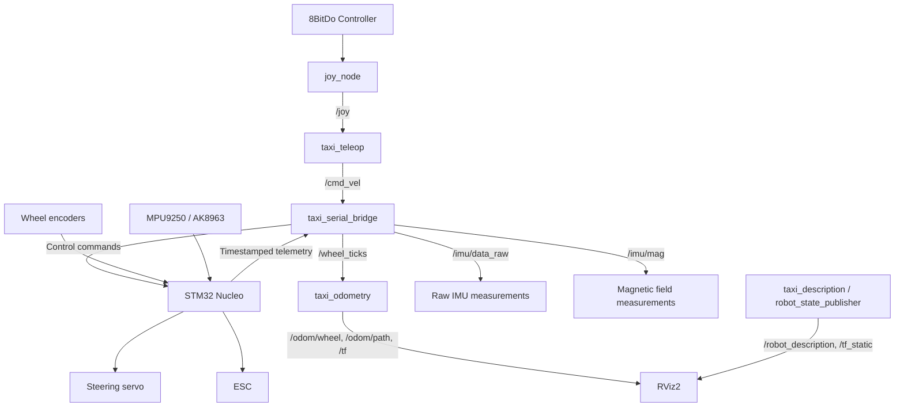

# Autonomous Taxi

Autonomous mobile robot project based on ROS 2, using a Tamiya TT-02 vehicle platform.

The system uses a Raspberry Pi for high-level robotics tasks and an STM32 microcontroller for low-level real-time control and sensor acquisition. A remote development computer provides RViz visualization and development tools.

## Hardware

| Component | Model |
|---|---|
| Vehicle platform | Tamiya TT-02 |
| Main computer | Raspberry Pi 4 Model B |
| Microcontroller | STM32 Nucleo L432KC |
| ESC | Tamiya TBLE-04S |
| Wheel encoders | 2 × E38S6G5-600B-G24N |
| IMU | Grove 10DOF v2.1 (MPU9250, AK8963, BMP280) |
| LiDAR | SLAMTEC RPLIDAR A2M8 |
| GPS | NL-302U |
| Controller | 8BitDo Ultimate 2C Wireless Controller |

The LiDAR driver has been tested independently. GPS integration and the use of barometric measurements are not part of the current vehicle bringup.

## Software

- Ubuntu Server 26.04 ARM64 (Raspberry Pi)
- ROS 2 Lyrical
- RViz2, Xacro and robot_state_publisher (visualization computer)
- STM32CubeIDE / STM32 HAL
- SLAMTEC `sllidar_ros2`
- colcon, rosdep and vcstool
- Tailscale for remote connectivity

## System Architecture



The current localization estimate is based exclusively on wheel encoders. IMU measurements are available in ROS 2 but are not yet fused with wheel odometry.

## Repository Structure

```text
Autonomous-Taxi/
├── dependencies.repos
├── firmware/
│   └── stm32_vehicle_controller/
├── patches/
│   └── sllidar_ros2-lyrical.patch
├── scripts/
│   └── setup_dependencies.sh
├── ros2_ws/
│   └── src/
│       ├── taxi_bringup/
│       ├── taxi_description/
│       ├── taxi_examples/
│       ├── taxi_interfaces/
│       ├── taxi_odometry/
│       ├── taxi_serial_bridge/
│       ├── taxi_teleop/
│       └── third_party/       # generated, not tracked by Git
└── README.md
```

### ROS 2 Packages

| Package | Responsibility |
|---|---|
| `taxi_bringup` | Centralized vehicle and visualization launch files |
| `taxi_description` | F1TENTH-based vehicle description and static TF |
| `taxi_examples` | ROS 2 examples and development tests |
| `taxi_interfaces` | Custom messages, including `WheelTicks` |
| `taxi_odometry` | Wheel odometry, dynamic TF and trajectory publishing |
| `taxi_serial_bridge` | Bidirectional serial communication and sensor telemetry |
| `taxi_teleop` | Gamepad teleoperation and command safety |

## External Dependencies

Third-party ROS packages are declared in `dependencies.repos`. They are downloaded with vcstool and are not committed directly to this repository.

The SLAMTEC ROS 2 driver requires a compatibility patch for ROS 2 Lyrical, located at `patches/sllidar_ros2-lyrical.patch`.

The dependency setup is automated by:

```bash
./scripts/setup_dependencies.sh
```

Before running the script for the first time, initialize rosdep:

```bash
sudo rosdep init
rosdep update
```

## Build

From the repository root, source ROS 2 and configure external dependencies:

```bash
source /opt/ros/lyrical/setup.bash
./scripts/setup_dependencies.sh
```

Build the workspace:

```bash
cd ros2_ws
colcon build --symlink-install
source install/setup.bash
```

The visualization launch requires RViz2, Xacro and robot_state_publisher on the visualization computer. RViz2 is not needed at runtime on the Raspberry Pi for `vehicle.launch.py`.

## Running the System

### Raspberry Pi — Vehicle Bringup

Connect the STM32 through USB and the gamepad through its wireless USB receiver. Stop any individually running vehicle nodes before launching the complete stack.

```bash
cd ros2_ws
source /opt/ros/lyrical/setup.bash
source install/setup.bash
ros2 launch taxi_bringup vehicle.launch.py
```

This starts gamepad teleoperation, the serial bridge and wheel odometry.

### Development Computer — Visualization

Use the same ROS domain and a working ROS 2 discovery configuration between the two machines. For the current Tailscale setup, configure `ROS_STATIC_PEERS` with the Raspberry Pi's reachable address as needed, and ensure discovery is configured on the vehicle side as well.

```bash
cd ros2_ws
source /opt/ros/lyrical/setup.bash
source install/setup.bash
export ROS_STATIC_PEERS="YOUR_RASPBERRY_PI_TAILSCALE_IP"
ros2 launch taxi_bringup visualization.launch.py
```

Replace the placeholder with the actual IP address before executing the export command.

The launch starts `robot_state_publisher` and RViz2 using the saved configuration in `taxi_bringup/rviz/vehicle.rviz`. The visualization includes the vehicle model, a grid and the estimated trajectory in the `odom` frame.

## Gamepad Teleoperation

Manual teleoperation uses the 8BitDo Ultimate 2C wireless gamepad. The mapping is stored in `ros2_ws/src/taxi_teleop/config/8bitdo_ultimate_2c.yaml`.

| Input | Function |
|---|---|
| Left stick horizontal | Steering |
| RT | Forward throttle |
| LT | Reverse throttle |
| LB | Deadman / enable button |

Teleoperation can also be started independently for development:

```bash
ros2 launch taxi_teleop gamepad_teleop.launch.py
```

Vehicle commands are published on `/cmd_vel` using `geometry_msgs/msg/Twist`. In the current manual-control implementation, the relevant fields represent normalized control inputs rather than calibrated physical velocity and yaw-rate setpoints.

## Vehicle Control

Low-level control is handled by the STM32 Nucleo-L432KC. The Raspberry Pi sends normalized commands through the ST-LINK Virtual COM Port, normally `/dev/ttyACM0`, at 115200 baud.

### STM32 Connections

| Function | STM32 Pin | Peripheral |
|---|---|---|
| Steering servo signal | PA8 / D9 | TIM1_CH1 |
| ESC signal | PA11 / D10 | TIM1_CH4 |
| Raspberry Pi communication | ST-LINK USB | USART2 VCP |

Both PWM channels operate at 50 Hz.

### Calibration

**Steering calibration:**

- **1100 µs** — left endpoint
- **1400 µs** — mechanical center
- **1700 µs** — right endpoint

The steering direction is inverted in firmware to preserve ROS conventions (`angular.z > 0` for left, `angular.z < 0` for right).

**ESC calibration:**

- **1500 µs** — neutral
- **~1600 µs** — forward starts
- **1900 µs** — full forward
- **~1200 µs** — reverse region
- **1100 µs** — reverse endpoint

The ESC requires an explicit neutral command when changing driving direction. This behavior is handled automatically by the STM32 firmware.

### Serial Protocol

The protocol is ASCII-based and bidirectional. Control commands are sent at 20 Hz, and unified sensor telemetry is emitted at approximately 10 Hz.

**Raspberry Pi → STM32:**

```text
C,<steering>,<throttle>
```

Both values are normalized integers in the range `-1000` to `1000`.

Examples: `C,0,0`, `C,500,0`, `C,0,500`, `C,0,-500`.

**STM32 → Raspberry Pi:**

```text
T,<timestamp_ms>,<left_ticks>,<right_ticks>,<imu_valid>,<ax>,<ay>,<az>,<gx>,<gy>,<gz>,<mag_valid>,<mx>,<my>,<mz>
```

| Field | Description |
|---|---|
| `timestamp_ms` | STM32 millisecond timestamp (unsigned 32-bit) |
| `left_ticks`, `right_ticks` | Signed cumulative 64-bit encoder counts |
| `imu_valid`, `mag_valid` | Sensor measurement validity flags |
| `ax`, `ay`, `az` | Accelerometer measurements in calibrated sensor counts |
| `gx`, `gy`, `gz` | Gyroscope measurements in calibrated sensor counts |
| `mx`, `my`, `mz` | Magnetometer measurements in calibrated sensor counts |

The serial bridge converts sensor measurements to ROS-compatible SI units and publishes valid sensor data. Messages from the same telemetry packet share a ROS reception timestamp; the original STM32 timestamp is retained in `WheelTicks` for odometry timing.

### Safety

The control chain contains multiple safety layers:

- **Deadman switch:** `taxi_teleop` commands zero velocity if LB is released.
- **Joystick watchdog:** commands zero velocity if `/joy` messages stop arriving.
- **Bridge watchdog:** outputs neutral commands if `/cmd_vel` stops arriving (300 ms timeout).
- **STM32 serial watchdog:** returns steering to center and the ESC to neutral after 500 ms without valid commands.
- **UART fault recovery:** recovers UART reception after communication errors and requires a neutral command (`C,0,0`) before accepting motion commands again.
- **Power separation:** the ESC/servo system uses the ESC BEC (measured at 6 V). The STM32 remains USB-powered, with a common ground between the vehicle and control electronics.

### Wheel Encoders

Two E38S6G5-600B-G24N incremental rotary encoders are used for wheel odometry.

- Resolution: 600 PPR (2400 counts/revolution with ×4 decoding)
- Encoder wheel diameter: 61 mm
- Left encoder: TIM2 (32-bit counter)
- Right encoder: LPTIM1 (16-bit counter)
- Power supply: 6 V from ESC BEC
- Signal pull-ups: 4.7 kΩ to 3.3 V
- Positive counting direction: forward motion
- Counter overflow: signed modular increments accumulated into 64-bit totals

#### Pin Mapping

| Component | Signal | Nucleo Pin | STM32 Pin |
|---|---|---|---|
| Left encoder | A | A1 | PA1 |
| Left encoder | B | A0 | PA0 |
| Right encoder | A | D11 | PB5 |
| Right encoder | B | A4 | PB7 |
| IMU | SDA | D0 | PA10 |
| IMU | SCL | D1 | PA9 |
| Steering servo | PWM | D9 | PA8 |
| ESC | PWM | D10 | PA11 |

I2C1 is remapped to PA9 and PA10 to avoid conflicts with LPTIM1. IMU communication on these pins has been validated.

#### Encoder Validation

- [x] Electrical signals verified with oscilloscope
- [x] Independent hardware counters
- [x] Quadrature ×4 decoding
- [x] Forward and reverse counting
- [x] Serial encoder telemetry at 10 Hz
- [x] Compatibility with manual gamepad control
- [x] Counter overflow handling
- [x] ROS 2 encoder integration
- [x] Wheel odometry computation and functional visualization
- [ ] Quantitative validation of odometry accuracy

## IMU Integration and Calibration

The Grove 10DOF v2.1 board provides an MPU9250 accelerometer and gyroscope, an AK8963 magnetometer and a BMP280 barometer.

The accelerometer and gyroscope are acquired through I2C. The magnetometer is accessed through the MPU9250's I2C bypass mode.

Implemented calibration procedures:

- Gyroscope: stationary bias estimation.
- Accelerometer: six-position calibration with per-axis bias and scale corrections.
- Magnetometer: factory sensitivity adjustment followed by per-axis bias and scale calibration.

Calibrated measurements are included in the unified STM32 telemetry and published in ROS 2 in the `imu_link` frame. Acceleration is expressed in m/s², angular velocity in rad/s and magnetic field in tesla.

No orientation estimate is provided by the raw IMU message. The magnetometer still requires independent validation and evaluation of interference from the motor and vehicle electronics. Sensor fusion and barometer integration are pending.

## ROS 2 Topics

| Topic | Message type | Description |
|---|---|---|
| `/joy` | `sensor_msgs/msg/Joy` | Gamepad input |
| `/cmd_vel` | `geometry_msgs/msg/Twist` | Vehicle control command |
| `/wheel_ticks` | `taxi_interfaces/msg/WheelTicks` | Timestamped cumulative encoder counts |
| `/imu/data_raw` | `sensor_msgs/msg/Imu` | Calibrated acceleration and angular velocity |
| `/imu/mag` | `sensor_msgs/msg/MagneticField` | Calibrated magnetic field |
| `/odom/wheel` | `nav_msgs/msg/Odometry` | Encoder-based pose and velocity |
| `/odom/path` | `nav_msgs/msg/Path` | Estimated trajectory |
| `/robot_description` | `std_msgs/msg/String` | Vehicle URDF description |
| `/tf` | `tf2_msgs/msg/TFMessage` | Dynamic transforms |
| `/tf_static` | `tf2_msgs/msg/TFMessage` | Static transforms |
| `/scan` | `sensor_msgs/msg/LaserScan` | LiDAR scans (standalone driver) |

The custom `WheelTicks` message contains:

```text
std_msgs/Header header
uint32 timestamp_ms
int64 left_ticks
int64 right_ticks
```

Basic telemetry validation:

```bash
ros2 topic hz /wheel_ticks
ros2 topic echo /imu/data_raw --once
ros2 topic echo /imu/mag --once
ros2 topic echo /odom/wheel --once
ros2 run tf2_ros tf2_echo odom base_link
```

## Wheel Odometry

The `taxi_odometry` package estimates the planar vehicle pose from the cumulative counts of two passive encoder wheels, positioned approximately along the rear axle.

### Parameters

| Parameter | Value |
|---|---|
| Encoder wheel radius | 0.0305 m |
| Counts per revolution | 2400 |
| Left encoder lateral offset | 0.0970 m |
| Right encoder lateral offset | 0.0934 m |
| Distance between encoder wheels | 0.1904 m |

For each telemetry update, the node computes the signed left and right wheel displacements from the change in encoder counts:

```text
meters_per_tick = 2πr / N
track_width = left_offset + right_offset

dl = delta_left_ticks  × meters_per_tick
dr = delta_right_ticks × meters_per_tick

ds = (right_offset × dl + left_offset × dr) / track_width
dtheta = (dr - dl) / track_width
```

The asymmetric encoder offsets are accounted for when estimating displacement along the vehicle centerline. The pose is integrated using the midpoint heading, and velocities are derived from the STM32 timestamp difference.

The estimate assumes planar motion, approximately rear-axle-aligned encoder wheels and negligible lateral slip. The pose starts at the origin when the node is launched. Odometry covariance values remain provisional until experimental validation.

### TF Architecture

```text
odom
└── base_link                    # dynamic: taxi_odometry
    ├── laser_model             # static: visual representation
    ├── back_left_wheel
    ├── back_right_wheel
    ├── front_left_hinge
    │   └── front_left_wheel
    └── front_right_hinge
        └── front_right_wheel
```

The wheel odometry node publishes `odom → base_link`. The `robot_state_publisher` publishes the fixed model transforms. The raw IMU uses `imu_link`, whose physical transform is not yet integrated into this model. The `laser_model` frame represents visual geometry, not a calibrated transform for the physical LiDAR.

When sensor fusion is introduced, ownership of the dynamic odometry transform must be coordinated to avoid multiple publishers for `odom → base_link`.

## RViz Visualization

The `taxi_description` package contains an adapted F1TENTH racecar Xacro model. It is used as an approximate visual representation of the TT-02, with static wheel joints and no steering animation. The original model license is retained in `taxi_description/LICENSE-F1TENTH`.

Upstream model: [F1TENTH Gym ROS](https://github.com/f1tenth/f1tenth_gym_ros).

The trajectory is published on `/odom/path` and displayed as a line in RViz:

- Minimum distance between stored points: 1 cm.
- Maximum trajectory length: 2000 stored poses.
- Publication rate: 2 Hz.
- The trajectory is cleared when wheel odometry is restarted.

The RViz configuration is stored in `ros2_ws/src/taxi_bringup/rviz/vehicle.rviz`.

## RPLIDAR A2M8

The LiDAR is connected through USB and normally appears as `/dev/ttyUSB0`. The A2M8 uses a serial baud rate of 115200.

Start the standalone ROS 2 driver:

```bash
ros2 launch sllidar_ros2 sllidar_a2m8_launch.py
```

The driver publishes `/scan` using `sensor_msgs/msg/LaserScan`.

Basic validation commands:

```bash
ros2 topic info /scan
ros2 topic hz /scan
ros2 topic echo /scan --once
```

The hardware test produced valid 360-degree scans using the Sensitivity scan mode. Integration into vehicle bringup and the physical TF tree is pending.

## Project Roadmap

- [x] Raspberry Pi and ROS 2 environment setup
- [x] Standalone LiDAR driver validation
- [x] Manual gamepad teleoperation
- [x] STM32 vehicle control and safety mechanisms
- [x] Wheel encoder integration and overflow handling
- [x] IMU integration and initial calibration
- [x] Unified sensor telemetry and ROS 2 serial bridge
- [x] Wheel odometry and dynamic TF broadcasting
- [x] Vehicle model and trajectory visualization in RViz
- [x] Centralized vehicle and visualization bringup
- [ ] Quantitative wheel odometry validation
- [ ] Wheel odometry and IMU sensor fusion (EKF)
- [ ] Integrated LiDAR and calibrated sensor transforms
- [ ] GPS integration and global localization
- [ ] Autonomous navigation

The current milestone is a manually controlled vehicle with ROS 2 sensor telemetry, encoder-based odometry and remote visualization. Quantitative localization accuracy and autonomous navigation have not yet been validated.